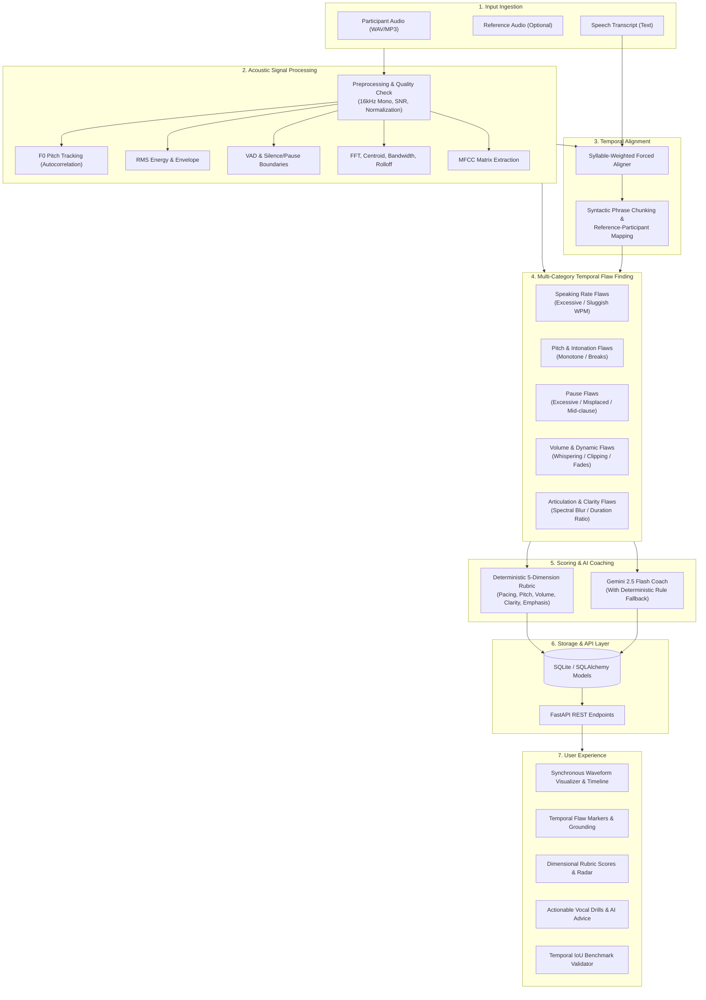

# Counterpoint AI: Speech Analytics & Temporal Flaw Finding
## Comprehensive Implementation Plan

### 1. Executive Summary & System Architecture

**Counterpoint AI** is a speech analytics and temporal flaw detection platform designed to evaluate oral presentations and competitive speaking performances. By pairing acoustic signal processing (RMS energy, F0 pitch contours, MFCCs, spectral moments) with forced phonetic alignment and reference-guided comparative analysis, the system detects, timestamps, and explains fine-grained vocal delivery flaws.



---

### 2. Current Implementation Status vs. Remaining Work

| Component | Status | Existing Files | Pending Deliverables |
| :--- | :--- | :--- | :--- |
| **Data Models & Schemas** | Completed | [`models.py`](file:///d:/Speech%20interpreter/backend/app/models/models.py), [`schemas.py`](file:///d:/Speech%20interpreter/backend/app/schemas/schemas.py), [`session.py`](file:///d:/Speech%20interpreter/backend/app/database/session.py) | None |
| **Audio Feature Extraction** | Completed | [`preprocessing.py`](file:///d:/Speech%20interpreter/backend/app/audio/preprocessing.py), [`pitch_analysis.py`](file:///d:/Speech%20interpreter/backend/app/audio/pitch_analysis.py), [`pause_detection.py`](file:///d:/Speech%20interpreter/backend/app/audio/pause_detection.py), [`speaking_rate.py`](file:///d:/Speech%20interpreter/backend/app/audio/speaking_rate.py), [`waveform.py`](file:///d:/Speech%20interpreter/backend/app/audio/waveform.py), [`fft_analysis.py`](file:///d:/Speech%20interpreter/backend/app/audio/fft_analysis.py), [`mfcc_analysis.py`](file:///d:/Speech%20interpreter/backend/app/audio/mfcc_analysis.py) | Validation checks |
| **Forced Alignment & Mapping** | Completed | [`aligner.py`](file:///d:/Speech%20interpreter/backend/app/alignment/aligner.py), [`transcript_mapping.py`](file:///d:/Speech%20interpreter/backend/app/alignment/transcript_mapping.py) | Unaligned fallback handling |
| **Temporal Flaw Detectors** | Partially Completed | [`rate_detector.py`](file:///d:/Speech%20interpreter/backend/app/detection/rate_detector.py), [`pitch_detector.py`](file:///d:/Speech%20interpreter/backend/app/detection/pitch_detector.py), [`pause_detector.py`](file:///d:/Speech%20interpreter/backend/app/detection/pause_detector.py) | `volume_detector.py`, `clarity_detector.py`, `emphasis_detector.py`, `detector_registry.py` |
| **Rubric Scoring Engine** | Not Started | Empty | `backend/app/scoring/rubric_engine.py` |
| **Feedback & AI Coaching** | Not Started | Empty | `backend/app/feedback/coaching_engine.py` |
| **Pipeline Orchestrator** | Not Started | Empty | `backend/app/services/analysis_service.py` |
| **Dataset & Evaluation** | Not Started | Empty | `backend/app/dataset/seed_dataset.py`, `backend/app/evaluation/temporal_iou.py` |
| **FastAPI REST API** | Not Started | Empty | `backend/app/api/`, `backend/main.py` |
| **Frontend Application** | Not Started | Empty | Full interactive Web Application (HTML/CSS/JS or Vite) |
| **Automated Tests** | Not Started | Empty | Unit, pipeline, and API test suite in `backend/tests/` |

---

### 3. Step-by-Step Implementation Roadmap

#### Phase 1: Complete Remaining Flaw Detectors & Flaw Registry
1. **`backend/app/detection/volume_detector.py`**:
   - Detects `whispering_low_volume` (RMS < 35% of participant median or reference).
   - Detects `volume_instability_fade` (gradual attenuation across trailing sentences).
   - Detects `excessive_loudness_spike` (sharp RMS clipping or sudden 8+ dB peaks).
2. **`backend/app/detection/emphasis_detector.py`**:
   - Detects `lack_of_emphasis` on crucial argumentative words (keywords lacking pitch rise or RMS boost).
   - Detects `misplaced_emphasis` on function words ("the", "and", "in") interrupting cadence.
3. **`backend/app/detection/clarity_detector.py`**:
   - Compares spectral centroid dynamics and high-frequency energy ratio to identify slurred or mumbled segments.
4. **`backend/app/detection/detector_registry.py`**:
   - Central aggregation function `run_all_detectors(...)` that collects, deduplicates overlapping spans, ranks flaws by severity (`high`, `medium`, `low`), and generates structured `EvidenceItem` telemetry.

#### Phase 2: Deterministic Rubric Scoring Engine
1. **`backend/app/scoring/rubric_engine.py`**:
   - Implements 5 calibrated dimensions:
     - **Pacing Score (25%)**: Evaluates WPM consistency, deviation from reference (target 130–160 WPM), and rate volatility.
     - **Pitch & Intonation Score (20%)**: Evaluates F0 standard deviation, melodic range, absence of monotone intervals.
     - **Volume & Dynamics Score (20%)**: Measures RMS dynamic contrast, avoidance of trailing drops or ear-splitting peaks.
     - **Pronunciation & Clarity Score (20%)**: Evaluates spectral clarity, phoneme duration consistency, and articulation sharpness.
     - **Emphasis & Cadence Score (15%)**: Assesses focal stress alignment, rhetorical rhythm, and appropriate syntactic pausing.
   - Computes weighted overall score (0.0 to 100.0) with detailed dimensional justifications.

#### Phase 3: Gemini Speech Coach & Deterministic Fallback Engine
1. **`backend/app/feedback/coaching_engine.py`**:
   - Uses `google-genai` SDK (`gemini-2.5-flash`).
   - Grounded prompt injection: Sends objective flaw evidence, timestamps, exact text spans, and score breakdown.
   - Requests structured JSON schema: `summary`, `strengths`, `interpretations` (with root cause analysis, real-world impact, and targeted vocal exercises), `overall_recommendations`, and `limitations`.
   - **Deterministic Fallback Engine**: If `ENABLE_GEMINI=false` or API key is absent/fails, automatically synthesizes rule-based expert coaching tips directly from detected flaw evidence.

#### Phase 4: Analysis Pipeline Orchestration
1. **`backend/app/services/analysis_service.py`**:
   - Coordinates end-to-end processing:
     1. Save raw audio files to `data/raw/`.
     2. Preprocess & normalize audio to 16kHz mono.
     3. Extract acoustic features: pitch contour, pauses, RMS energy, spectral features, MFCCs.
     4. Perform forced alignment on transcript.
     5. Perform syntactic phrase chunking and reference-to-participant alignment.
     6. Execute all temporal flaw detectors.
     7. Compute rubric scores.
     8. Generate Gemini coaching interpretation (or fallback).
     9. Persist all records (`SpeechAnalysis`, `AudioRecording`, `WordAlignment`, `AcousticFeatureSummary`, `DetectedFlaw`, `RubricScore`, `GeminiInterpretation`) inside SQLite database.
     10. Support standalone participant analysis (heuristic baselines when no reference recording is provided).

#### Phase 5: Benchmark Dataset & Temporal Flaw Evaluation (IoU)
1. **`backend/app/evaluation/temporal_iou.py`**:
   - Evaluates detected flaw intervals $[t_{start}, t_{end}]$ against human ground truth annotations.
   - Temporal Intersection-over-Union:
     $$\text{IoU}(A, B) = \frac{\max(0, \min(A_{end}, B_{end}) - \max(A_{start}, B_{start}))}{\max(A_{end}, B_{end}) - \min(A_{start}, B_{start})}$$
   - Computes Category-level Precision, Recall, F1-score (at configurable $\text{IoU} \ge 0.5$ threshold) and confusion matrix.
2. **`backend/app/dataset/seed_dataset.py`**:
   - Generates pre-populated test corpus with authentic audio samples and synthetic temporal perturbations (pacing shifts, artificial silences, monotone flattening).
   - Seeds ground-truth human annotations into SQLite for immediate validation and benchmarking.

#### Phase 6: FastAPI REST API
1. **`backend/main.py` & `backend/app/api/`**:
   - `GET /api/health` & `GET /api/status`: Check database, audio storage, Gemini connectivity, model statuses.
   - `POST /api/analyses`: Multipart upload (`participant_audio`, optional `reference_audio`, `transcript`, `title`, `category`).
   - `GET /api/analyses`: Paginated list of speech evaluations with status and score summaries.
   - `GET /api/analyses/{id}`: Full analysis payload with alignments, feature time series, flaws, scores, and coaching advice.
   - `DELETE /api/analyses/{id}`: Clean removal of analysis record and associated audio files.
   - `GET /api/analyses/{id}/audio/{role}`: Stream raw or processed audio with HTTP 206 partial content support.
   - `GET /api/dataset/samples` & `POST /api/dataset/evaluate`: Run benchmark evaluation across all annotated samples.
   - `GET /api/settings` & `PUT /api/settings`: Read and update rubric weights and Gemini API configurations.

#### Phase 7: Interactive High-Aesthetic Web Application
1. **Visual System & User Experience**:
   - Modern dark-mode interface with glassmorphic cards, HSL accent colors, and responsive typography (Inter/Outfit).
   - **Multi-Track Audio Visualizer**:
     - Synchronous twin waveform player for Reference and Participant.
     - Interactive scrubber, playback speed controls, and segment looping.
   - **Temporal Flaw Timeline**:
     - Visual markers placed directly on the timeline corresponding to detected flaws.
     - Color-coded severity chips (`High` in crimson, `Medium` in amber, `Low` in cyan).
     - Hover inspection showing delta metrics (e.g., `+34% WPM`, `3.2s pause`, `monotone 8.4 Hz std`).
   - **Rubric & Score Breakdown Panel**:
     - Overall score badge (0–100) with grade tier.
     - Interactive 5-axis dimensional breakdown bars with hover justifications.
   - **AI Speech Coach Panel**:
     - Highlighted strengths, targeted flaw explanations, and step-by-step vocal practice drills.
   - **Evaluation & Benchmark Dashboard**:
     - Live temporal IoU metrics, per-category F1 scores, and test dataset viewer.
   - **Upload & Evaluation Studio**:
     - Drag-and-drop audio file uploader with live waveform preview and transcript editor.

#### Phase 8: Verification, Test Suite & Documentation
1. **Unit & Integration Tests**:
   - `test_audio.py`: Preprocessing, pitch extraction, pause detection.
   - `test_alignment.py`: Word alignment and phrase segment matching.
   - `test_flaws.py`: Detection accuracy on synthetic flaw audio.
   - `test_scoring.py`: Mathematical consistency of rubric calculations.
   - `test_api.py`: FastAPI endpoints and upload workflows.
2. **Setup Script & Documentation**:
   - `README.md` with installation commands, architecture explanation, and usage guide.
   - Shell startup script for seamless single-command launch.

---

### 4. Flaw Detection Catalog & Thresholds

| Flaw Category | Acoustic Features Checked | Trigger Threshold | Severity Assignment |
| :--- | :--- | :--- | :--- |
| `excessive_speaking_rate` | Aligned phrase WPM | WPM $> 180$ or $> +25\%$ above reference | $> +40\% \rightarrow \text{High}$, else $\text{Medium}$ |
| `unusually_slow_rate` | Aligned phrase WPM | WPM $< 100$ or $< -25\%$ below reference | $< -40\% \rightarrow \text{High}$, else $\text{Medium}$ |
| `excessive_pause` | VAD silence duration | Pause duration $\ge 1.6\text{s}$ | $\ge 2.4\text{s} \rightarrow \text{High}$, else $\text{Medium}$ |
| `misplaced_pause` | Pause vs. syntactic clause | Silence $\ge 0.5\text{s}$ splitting non-punctuated word pair | Non-clause break $\rightarrow \text{Medium}$ |
| `flat_intonation` | F0 standard deviation ($\text{std}(f_0)$) | Segment $f_0 \text{ std} < 12\text{ Hz}$ while ref $\ge 22\text{ Hz}$ | $< 8\text{ Hz} \rightarrow \text{High}$, else $\text{Medium}$ |
| `pitch_break_instability` | Frame-to-frame $f_0$ octave jumps | $|f_0(t) - f_0(t-1)| > 80\text{ Hz}$ in consecutive voiced frames | Spike count $\ge 3 \rightarrow \text{High}$ |
| `whispering_low_volume` | Segment RMS energy | RMS $< 35\%$ of participant baseline | $< 20\% \rightarrow \text{High}$, else $\text{Medium}$ |
| `volume_drop_trailing` | End-of-sentence RMS trend | Trailing 3 words decay $> 6\text{ dB}$ faster than reference | Drop $> 9\text{ dB} \rightarrow \text{High}$ |
| `lack_of_emphasis` | Key argumentative words (POS/Lexical) | Word RMS and $f_0$ below segment mean | Delta $< -25\% \rightarrow \text{Medium}$ |

---

### 5. Execution Order

```
[Phase 1] Detectors (Volume, Emphasis, Clarity, Registry)
   ↓
[Phase 2] Rubric Scoring Engine (5 Dimensions, Weighted Sum)
   ↓
[Phase 3] Gemini 2.5 Flash Coach + Deterministic Rule Fallback
   ↓
[Phase 4] Orchestrator Service (Full Ingestion Pipeline)
   ↓
[Phase 5] Benchmark Dataset & Temporal IoU Evaluation
   ↓
[Phase 6] FastAPI Backend Server & Endpoints
   ↓
[Phase 7] Web Application Frontend (Waveform, Timeline, Coach)
   ↓
[Phase 8] Test Suite & Validation Benchmark Run
```
